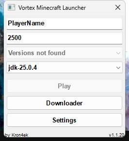
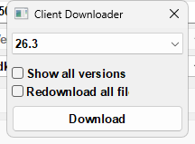
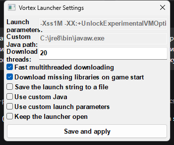

<div align="center">

# 🌀 Vortex Launcher — порт на C++

**Полный перенос [Vortex Minecraft Launcher][original] от [Kron4ek][kron] на чистый C++17 без единой внешней зависимости.**

Чистый Win32 API · без фреймворков · без сторонних библиотек · сборка одной командой `build.bat`

[](LICENSE)
[](https://isocpp.org)
[](#сборка)
[](#сборка)

[English](README.md) · **Русский**

</div>

---

Это **порт оригинальных PureBasic-исходников** Vortex Launcher **v1.1.20** на современный C++.
Порт написан по [оригинальному исходному коду][source-pb] (`vlauncher_windows.pb`, тег `1.1.20`) — процедура за
процедурой, строка за строкой, — **а не** по дизассемблированию или декомпилированному коду. Цель — поведенческая
копия 1:1: тот же интерфейс, те же диалоги, тот же формат конфигурации, те же настройки по умолчанию и — намеренно —
те же особенности оригинала 1.1.20.

## Скриншоты

| Главное окно | Client Downloader | Настройки |
|:---:|:---:|:---:|
|  |  |  |

## Возможности

* Лаунчер оффлайн-режима: никнейм, объём RAM, выбор установленной версии, кнопка **Play**.
* Встроенный **Client Downloader**: загружает манифест версий Mojang, показывает все релизы/снапшоты и скачивает
  выбранную версию со всеми библиотеками, клиентским jar и ассетами (проверка MD5, многопоточность).
* Автоматический **поиск Java** (популярные расположения JDK/JRE) или указание своего пути.
* Формирует `launcher_profiles.json` / `launcher_log.txt` и запускает игру; умеет сохранять строку запуска.
* Настройки: кастомные параметры запуска, «держать лаунчер открытым», перескачивать все файлы, докачка библиотек
  при старте и т. д.
* Конфиг — файл `vortex_launcher.conf` **того же формата, что у оригинала**.

## Чем порт заменяет PureBasic

| PureBasic (оригинал) | C++ (этот порт) |
|---|---|
| PB-гаджеты и формы | чистый Win32: `user32`, `gdi32`, `comctl32` v6 |
| `ReceiveHTTPMemory` / `ReceiveHTTPFile` | `winhttp` (редиректы, TLS 1.2/1.3, те же таймауты) |
| `ParseJSON` + `ExamineJSONMembers` | свой JSON-парсер, **сохраняющий порядок членов** как у PB |
| `OpenPack` / `ExtractPackFile` (natives-jar) | свой читатель ZIP + inflate по RFC 1951 |
| `CryptCreateHashData(#PB_Hash_MD5)` | `crypt32`, `CALG_MD5` |
| Preferences PB | тот же файл `vortex_launcher.conf` и та же секция |
| рантайм PureBasic | отсутствует: статический CRT (`/MT`), один exe ~350 КБ |

Внутри все строки UTF-8, к UI — через широкие Win32-API: не-ASCII ники и пути работают.

## Точность переноса

Порт воспроизводит поведение оригинала там, где это важно: размеры окон (250×250 главное, 200×120 загрузчик,
335×255 настройки, 230×85 прогресс), расположение элементов, тексты сообщений, порядок действий и даже известные
особенности оригинала (асинхронная загрузка использует `потоков + 1` слот; счётчик повторов при синхронной загрузке
общий для всех файлов; `findJava` останавливается на первом не-каталоге; версии с пробелами переименовываются на
диске). Это сохранено намеренно: C++-сборка — замена Vortex Launcher 1.1.20 «один в один».
Поведение проверено на живом лаунчере: загрузка манифеста (≈210 КБ, 103 современные версии в порядке манифеста),
совпадение ключей и значений по умолчанию в `vortex_launcher.conf`, корректная семантика открытия/закрытия всех окон.

## Сборка

Нужны: **Windows 10/11 x64** и [Visual Studio 2017+ Build Tools][buildtools] с компонентом
*Desktop development with C++*. Больше ничего.

```bat
build.bat
```

Скрипт сам находит MSVC через `vswhere`, компилирует и линкует `VLauncher_cpp.exe` — один статический исполняемый
файл, без установщика. Эквивалент вручную (в окне *x64 Native Tools*):

```bat
rc /nologo /fo app.res res\app.rc
cl /nologo /EHsc /std:c++17 /O2 /MT /DUNICODE /D_UNICODE /D_CRT_SECURE_NO_WARNINGS ^
   src\app.cpp src\http.cpp src\zip.cpp /Fe:VLauncher_cpp.exe /Fo:obj\ ^
   /link /SUBSYSTEM:WINDOWS app.res ^
   winhttp.lib crypt32.lib advapi32.lib user32.lib gdi32.lib comctl32.lib
```

## Структура проекта

```
vortex-launcher-cpp/
├─ build.bat              сборка одной командой (MSVC)
├─ src/
│  ├─ app.cpp             все окна + логика лаунчера
│  ├─ http.cpp|hpp        WinHTTP: память / файл
│  ├─ zip.cpp|hpp         ZIP-читатель + inflate (natives-jar)
│  ├─ json.hpp            JSON-парсер с сохранением порядка
│  └─ util.hpp            строки, конфиг, MD5, запуск процессов
├─ res/
│  ├─ app.rc              иконка + манифест Common-Controls
│  ├─ app.manifest        активация comctl32 v6
│  └─ launcher_icon.ico   иконка (из оригинального проекта)
└─ docs/screenshots/      скриншоты выше
```

## Конфигурация

Все настройки — в файле `vortex_launcher.conf` рядом с exe, секция `[PureBasic-Preferences]`
(имя секции сохранено для совместимости с конфигами оригинала):
`Name`, `Ram`, `ChosenVer`, `DownloadThreads`, `AsyncDownload`, `DownloadMissingLibs`, `ShowAllVersions`,
`RedownloadFiles`, `SaveLaunchString`, `UseCustomJava`, `JavaPath`, `UseCustomParameters`, `LaunchArguments`,
`KeepLauncherOpen`. Файл от оригинального Vortex Launcher 1.1.20 работает здесь без изменений, и наоборот.

## Дисклеймер и торговые марки

Это **не официальный лаунчер**. *Minecraft* — торговая марка Mojang AB / Microsoft; проект с ними не связан
и ими не поддерживается. Игровые файлы загружаются только с публичных серверов Mojang
(`launchermeta.mojang.com`, `resources.download.minecraft.net`); требуется легальная копия игры.

## Лицензия

Порт на C++ распространяется под **GPL-3.0** — см. [LICENSE](LICENSE).

Это производная работа [Vortex Launcher][original] от [Kron4ek][kron] (исходники оригинала на PureBasic также под
GPL-3.0). Иконка лаунчера взята из оригинального проекта. Атрибуция оригинальным авторам приведена в соответствии
с требованиями лицензии; relicensing исходной работы здесь нет.

[original]: https://github.com/Kron4ek/minecraft-vortex-launcher
[kron]: https://github.com/Kron4ek
[source-pb]: https://github.com/Kron4ek/minecraft-vortex-launcher/blob/1.1.20/vlauncher_windows.pb
[buildtools]: https://visualstudio.microsoft.com/visual-cpp-build-tools/
